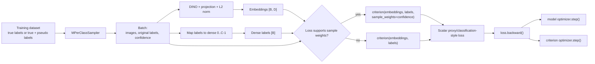
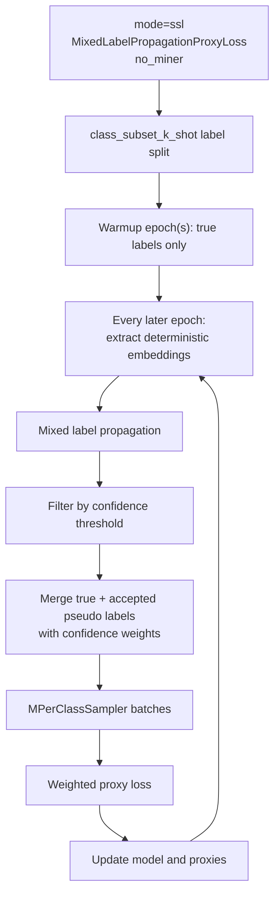

# Classification-Style Loss Data Flow And Config Variants

This document maps the repository's classification-style metric-loss branch.
These are proxy/class-weight losses from `pytorch-metric-learning`, plus the
project-local `MixedLabelPropagationProxyLoss`.

They are called "classification losses" by the runner because they own
learnable class/proxy parameters. They do **not** turn evaluation into ordinary
classifier prediction: validation and test still use embedding retrieval.

For shared setup, orchestration, splitting, HPO, CV, and artifacts, see
[End-to-end run data flow](run_data_flow.md).

## Branch Condition

The classification-style path is selected when `args.loss` belongs to
`CLASSIFICATION_LOSSES` in [`training/types.py`](../training/types.py):

```text
ArcFaceLoss
CosFaceLoss
LargeMarginSoftmaxLoss
MixedLabelPropagationProxyLoss
WeightRegularizerMixin
NormalizedSoftmaxLoss
ProxyAnchorLoss
ProxyNCALoss
SoftTripleLoss
SphereFaceLoss
SubCenterArcFaceLoss
```

The runner constructs the selected class as:

```python
criterion = LossClass(
    num_classes=len(set(dataset_bundle.train_dataset.labels)),
    embedding_size=model.feat_dim,
    **args.loss_params,
).to(device)
```

`num_classes` is the number of classes in `dataset_bundle.train_dataset` after
validation/CV rebuilding but before the final labeled-only or pseudo-labeled
`RelabeledSubset` is built. Consequently, a class-subset label budget can leave
criterion proxies that are not used by the batches when the rebuilt dataset
still retains unlabeled candidates.

## Complete Batch Flow



Miners are not constructed or called in this branch. Classification losses
must be paired with `no_miner` in an outer loss/miner grid.

## Two Optimizers

The runner always creates the normal model optimizer:

```text
parameters: trainable DINO/projection parameters
learning rate: lr
weight decay: weight_decay (default 0.0, disabled)
optimizer kind: optim
```

It also creates a criterion optimizer:

```text
parameters: criterion.parameters(), such as proxies/class weights
learning rate: classifier_lr
weight decay: weight_decay (default 0.0, disabled)
optimizer kind: same optim value as the model optimizer
```

For every batch, one backward pass populates gradients for both parameter sets.
The runner then logs both gradient norms and learning rates, steps both
optimizers, and clears both sets of gradients.

## What "Classification" Does And Does Not Mean

During training, the criterion compares each embedding with learnable class or
proxy parameters and sends gradients into:

- the embedding model;
- the criterion-owned proxies/class weights.

During validation and test:

- only the embedding model is used;
- the criterion and its proxies are ignored;
- retrieval Precision@1 and MAP@R are computed between evaluation embeddings.

Only `model.state_dict()` is stored in the temporary validation checkpoint.
Criterion/proxy and optimizer states are not checkpointed. This is sufficient
for the current post-training behavior because there is no later classifier
inference or resumed training after checkpoint restoration.

## Shared Input Contract

Like the standard path, classification-style losses receive:

```text
embeddings: L2-normalized [batch_size, embedding_size]
labels:     dense class IDs [batch_size], in [0, num_classes)
```

The `MPerClassSampler` is still used. A classification-style proxy loss can
operate with `sampler_m=1`, because it does not require two examples from a
class to create an in-batch positive pair. The normal sampler capacity rules
still apply.

## Variant 1: Ordinary Proxy/Class-Weight Loss

Examples include `ProxyAnchorLoss`, `ArcFaceLoss`, and
`NormalizedSoftmaxLoss`.

Per batch:

```python
loss = criterion(embeddings, labels)
loss.backward()
model_optimizer.step()
criterion_optimizer.step()
```

If the training dataset contains pseudo-label confidence, ordinary
`pytorch-metric-learning` classification losses do not consume it. Accepted
pseudo-labeled samples therefore contribute at full weight.

Typical fixed outer-grid pairing:

```json
{
  "loss_miner_grid": [
    "ProxyAnchorLoss:no_miner"
  ]
}
```

Typical HPO additions:

```json
{
  "spaces": {
    "classifier_lr": {
      "type": "float",
      "low": 1e-5,
      "high": 1.0,
      "log": true
    },
    "weight_decay": {
      "type": "float",
      "low": 1e-6,
      "high": 0.1,
      "log": true
    },
    "loss.ProxyAnchorLoss.alpha": {
      "type": "float",
      "low": 1.0,
      "high": 100.0
    },
    "loss.ProxyAnchorLoss.margin": {
      "type": "float",
      "low": 0.01,
      "high": 0.5
    }
  }
}
```

The legacy classification HPO JSON files tune `lr`, `feat_dim`, and
`batch_sampler` without an independent `classifier_lr`. Current configs that
extend `configs/runs/standardized_loss_params.json` instead tune both rates
indirectly through `base_lr` and `lr_ratio` for ArcFace and Proxy Anchor. They
still do not tune `weight_decay`. Use a categorical space when a search should
include the disabled value `0.0`.

The contrastive HPO config referenced by the non-`class/` CIFAR experiment
configs contains `loss.ProxyAnchor.*` keys. Even after correcting the top-level
loss name to `ProxyAnchorLoss`, those class-qualified keys would not apply
because `ProxyAnchor` does not equal the selected class name
`ProxyAnchorLoss`.

## Variant 2: `MixedLabelPropagationProxyLoss`

`MixedLabelPropagationProxyLoss` is a project-local classification-style loss
registered in [`losses/metric_losses.py`](../losses/metric_losses.py). It owns one trainable
proxy per class and declares:

```python
supports_sample_weights = True
```

This changes the per-batch call:

```python
loss = criterion(embeddings, labels, sample_weights=sample_weights)
```

True-labeled samples receive weight `1.0`. Pseudo-labeled samples receive the
confidence produced by the SSL method, after the confidence-threshold filter.

The loss:

1. normalizes embeddings and proxies;
2. computes embedding-to-proxy cosine similarities;
3. computes a positive term for the assigned class;
4. computes negative terms for every other proxy;
5. multiplies each sample's total by its confidence;
6. reduces using a class-count divisor.

The intended current experiment config is:

```text
configs/experiments/mixed_label_propagation_cifar100.json
```

Its flow is:



With the checked-in SSL config:

- pseudo-labels are regenerated every epoch;
- warmup is five labeled-only epochs and reuses the final proxy module and optimizer;
- k-shot defaults to 5 before any outer-grid override;
- confidence threshold is `0`;
- pseudo-label confidence directly scales loss contribution.

## Supervised Versus SSL Classification-Style Flow

### Supervised Mode

```text
loaded SSL config
-> converted to method=none
-> label selection retained
-> true-labeled RelabeledSubset only
-> all sample weights are 1.0
-> classification-style criterion + criterion optimizer
```

For `MixedLabelPropagationProxyLoss`, this is equivalent to unweighted proxy
training because every sample weight is `1.0`.

### SSL Mode

```text
enabled SSL method
-> labeled/unlabeled split
-> optional warmup
-> pseudo-label generation and filtering
-> true + accepted pseudo-labeled RelabeledSubset
-> classification-style criterion + criterion optimizer
```

Only losses declaring `supports_sample_weights` receive confidence. Other
classification-style losses ignore it.

## HPO Behavior For Classification-Style Losses

Before an HPO study starts:

- all miner constructor spaces are removed;
- selected-loss constructor spaces remain;
- class-qualified loss spaces for other loss classes are removed;
- categorical loss constructor combinations are checked using a temporary loss
  with `num_classes=2` and fixed `args.feat_dim or 128`;
- `classifier_lr` is sampled independently only if explicitly present as a
  plain HPO key;
- for `ArcFaceLoss` and `ProxyAnchorLoss`, the alternative `base_lr` plus
  `lr_ratio` spaces derive both `lr` and `classifier_lr` along the inverse-LR
  ridge and replace any inherited independent LR spaces.

In supervised mode, `ssl_config.confidence_threshold` and
`ssl_config.method_params.*` spaces are removed because pseudo-labeling is
disabled. Split-defining `ssl_config.labeled_per_class` can be retained where
applicable.

## Classification Experiment Config Matrix

The checked-in `configs/experiments/class/*.json` files all intend to run
`ProxyAnchorLoss:no_miner` in supervised mode with an outer grid and HPO. Their
different fields change the data flow as follows:

| Config | Dataset protocol | Label-budget scenarios | Validation/CV effect |
|---|---|---|---|
| `class/cifar10_config.json` | `cifar_balanced_fraction` | All classes selected; k varies over `4..400` | Four sample-stratified post-apportion folds. Train/validation can share classes. |
| `class/cifar100_config.json` | `cifar100_fine_class_disjoint` | All 60 development classes selected; k varies over `10..600` | Four stratified-group post-apportion folds. Final test uses different fine classes, while every superclass appears on both sides. |
| `class/cifar100_superclass_config.json` | `cifar100_superclass_disjoint` | All 50 development fine classes selected; k varies over `10..600` | Four stratified-group post-apportion folds. Final test uses ten completely held-out superclasses. |
| `class/cars196.json` | `official` | All development classes selected; k varies over `4..50` | Four stratified-group post-apportion folds, so train/validation classes are disjoint. |
| `class/sop_config.json` | `official` | `class_subset` selects fully labeled class fractions `0.01..0.5`; no k-shot grid | Four stratified-group post-apportion folds over the selected class subset. |

For every row, the top-level outer grid creates a separate scenario for each
label budget/k-shot value. Each scenario would run its own 50-trial Optuna
study, and each trial would train four fresh fold models.

`class_subset_k_shot` and `class_subset` can expose only part of the current
dataset's class set to supervised batches. With post-apportion CV in supervised
mode, the rebuilt fold training dataset contains only training-fold labeled
positions, so criterion class count matches that fold's represented labels.
In paths that retain unlabeled candidates in `dataset_bundle.train_dataset`,
the criterion can contain proxies that never receive a labeled training
example.

## Current Config Audit

This section describes the checked-in state as of June 12, 2026.

### Runnable Classification-Style Experiment Config

`configs/experiments/mixed_label_propagation_cifar100.json` names a registered
classification-style loss, uses `no_miner`, and points to an existing SSL
config.

It also specifies a `k_shot_grid`, so `main()` treats it as an outer grid. Each
k-shot scenario runs directly because no HPO config is specified.

### `configs/experiments/class/*.json`

These correctly request:

```text
ProxyAnchorLoss:no_miner
```

However, all four point to the missing path:

```text
configs/supervised/classification/proxy_anchor.json
```

They fail while loading the HPO config before any scenario or training run
starts.

Existing files under `configs/supervised/classification/` are:

```text
config_cifar.json
config_sop.json
conig_cars.json
```

They are not referenced by the checked-in `class/` experiment configs.

### Non-`class/` Supervised Experiment Configs

The checked-in:

```text
configs/experiments/cifar10_config.json
configs/experiments/cifar100_config.json
configs/experiments/cars196.json
configs/experiments/sop_config.json
```

request:

```text
ProxyAnchor:no_miner
```

`ProxyAnchor` is not in `ALL_LOSSES`; the registered class name is
`ProxyAnchorLoss`. These configs fail during outer-scenario loss/miner
validation before training.

Additionally, `configs/experiments/cars196.json` points to a missing HPO config:

```text
configs/supervised/triplet/nt_config_cifar100_k_shot_40_and_above.json
```

### Existing Classification HPO Config Behavior

The three existing classification HPO configs contain SSL confidence and
neighbor spaces. Because their intended experiment mode is supervised, those
SSL-only spaces are filtered out before Optuna runs. Their effective supervised
spaces are therefore limited to:

```text
lr
feat_dim
batch_sampler
```

## Primary Code Path

| Step | Implementation |
|---|---|
| Classification loss list | [`training/types.py`](../training/types.py) |
| Branch, second optimizer, batch calls | [`training/engine.py`](../training/engine.py) |
| Classification HPO filtering | [`training/hpo.py`](../training/hpo.py) |
| Weighted project-local proxy loss | [`losses/metric_losses.py`](../losses/metric_losses.py) |
| Confidence-bearing training dataset | [`training/semi_supervised.py`](../training/semi_supervised.py) |
| Retrieval-only evaluation | [`utils/`](../utils) |
