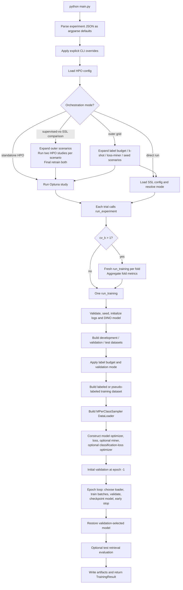
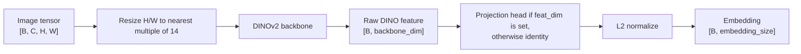
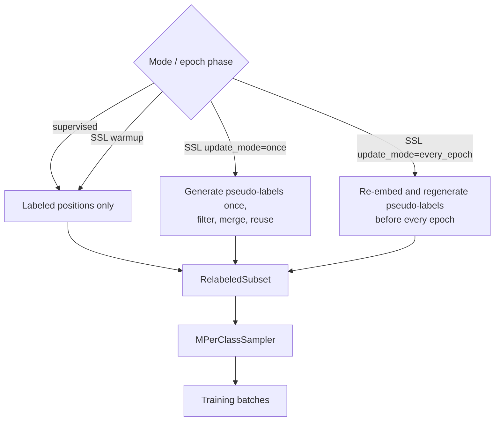

# End-to-End Run Data Flow

This document maps what happens from `python main.py` to the returned
`TrainingResult`. It covers direct runs, outer grids, HPO, cross-validation,
supervised label-budget runs, SSL runs, and final test retraining.

For the two loss-specific batch paths, see:

- [Standard metric-loss flow](standard_loss_data_flow.md)
- [Classification-style loss flow](classification_loss_data_flow.md)

## One-Screen Map



## 1. Configuration Resolution

The executable entry point is [`main.py`](../main.py). Before `main()` runs,
Windows-compatible multiprocessing is forced to `spawn`.

Configuration has three layers, in increasing precedence:

1. Argparse defaults from [`training/cli.py`](../training/cli.py).
2. Values from `--experiment-config`.
3. Explicit CLI arguments.

`parse_args_with_experiment_config()` first reads only the experiment-config
path, validates the JSON keys against argparse destinations, converts values
using the argparse types, and then parses the complete CLI over those defaults.

The top-level experiment config can point to two additional configs:

- `ssl_config`: label selection and pseudo-label generation.
- `hparam_config`: Optuna study settings and search spaces.

The resolved experiment, SSL, and HPO values are later persisted in run/study
metadata.

## 2. Top-Level Dispatch

`main()` dispatches from the broadest orchestration mode inward:

| Condition | What happens |
|---|---|
| `compare_supervised_ssl=true` | For each outer-grid scenario, run separate supervised and SSL HPO studies, then final-retrain both best configurations. |
| Any outer grid is present | Expand scenarios, then run HPO or a direct experiment for each scenario. |
| Enabled `hparam_config` | Run one Optuna study. Optionally final-retrain its best trial. |
| Otherwise | Run one direct experiment. |

`ssl_label_sampling_modes` has a parser default of
`["class_subset_k_shot"]`. Because any non-null grid field activates the outer
grid, a truly direct non-grid run requires `ssl_label_sampling_modes: null` and
all other outer-grid fields set to `null`.

An outer scenario is one Cartesian-product point over the configured:

- label sampling modes;
- label budgets;
- k-shot values;
- loss/miner pairs;
- seeds.

Each scenario gets a concrete SSL JSON under
`logs/<save_dir>/<grid-name>/ssl_configs/` before it is executed.

## 3. Mode Resolution

The loaded SSL config is transformed according to `mode`:

- `mode="ssl"` keeps the enabled pseudo-label method. An enabled SSL config is
  required.
- `mode="supervised"` converts the SSL config to `method="none"` while
  preserving label-selection mode, label budget, k-shot value, caps, and seed.

This means a supervised baseline still uses the SSL config to choose exactly
which examples are labeled. It simply never generates pseudo-labels.

## 4. HPO Flow

For every Optuna trial:

1. Applicable loss/miner constructor spaces are retained; class-qualified
   spaces for other selected classes are removed.
2. Sampler spaces are filtered against k-shot and label-budget capacity.
3. Optuna suggests values.
4. Plain keys update argparse values.
5. `batch_sampler="B:M"` updates both `batch_size=B` and `sampler_m=M`.
6. `loss.*` and `miner.*` values become constructor kwargs in `loss_params` and
   `miner_params`.
7. `ssl.*` or `ssl_config.*` values update the nested SSL dataclass.
8. Supervised mode removes pseudo-label behavior and supervised-irrelevant SSL
   search dimensions.
9. The trial calls `run_experiment()`.
10. The selected scalar from the returned `TrainingResult` becomes the Optuna
    objective.

Test evaluation is normally skipped during HPO. With `final_test_after_hpo`,
the best trial's selected fold epochs are averaged, and one fresh model is
built from the complete development source without a validation holdout. The
scenario's label selection is then reapplied, so supervised final training still
uses its selected labeled subset and SSL final training can use that subset plus
eligible unlabeled candidates. The model trains for the fixed selected duration
before one test evaluation.

For direct non-HPO runs, `evaluate_test=true` or `--evaluate-test` evaluates
`D_test` after the validation-selected checkpoint is loaded.

## 5. `run_experiment`: CV Or Single Fold

`run_experiment()` first resolves platform-specific DataLoader workers. On
Windows, configured training and SSL embedding worker counts become `0`.

Then:

- `cv_k == 1`: call `run_training()` once.
- `cv_k > 1`: call `run_training()` independently for every fold, with a fresh
  model and run directory each time, then average fold metrics.

Optuna receives per-epoch reports for a single-fold run or aggregate
completed-fold reports for CV.

## 6. Single-Fold Setup

`run_training()` performs setup in this order:

1. Normalize and validate arguments before loading expensive resources.
2. Seed Python, NumPy, Torch, and CUDA.
3. Create a timestamped `logs/<save_dir>/<timestamp>/` directory and log files.
4. Construct `DinoWrapper` and move it to the configured device.
5. Write `run_config.json`.
6. Build the dataset bundle.
7. Apply the label budget.
8. Apply validation splitting/downsampling.
9. Write the exact split manifest.
10. Build known static/warmup/evaluation loaders.
11. Build optimizers, loss, and optional miner.
12. Start validation and training.

## 7. Model Data Path



The projection head is one linear layer by default; `projection_layers` turns it
into a ReLU MLP with `projection_layers - 1` hidden layers of width
`projection_hidden_dim` (default: `backbone_dim`).

Backbone tuning controls which parameters receive gradients:

- `full`: all DINO parameters plus the optional projection.
- `last_N_blocks`: only the final N DINO blocks, final norm, and projection.
- `frozen`: only the required projection head.

With `use_cache=true`, the frozen DINO feature before projection is cached per
deterministically transformed image. Training augmentation is disabled, cached
features are loaded or created, and gradients flow through the projection only.

## 8. Dataset And Split Flow

`setup_dataset_bundle()` creates:

- `train_dataset`: a `Subset` with dense internal labels;
- `valid_dataset`;
- `test_dataset`;
- `train_labels_mapper`: original class ID to dense `0..C-1`;
- split metadata.

Training transform:

`RGB -> resize 224x224 -> RandAugment -> tensor -> normalize`

Validation, test, and pseudo-label feature transform:

`RGB -> resize 224x224 -> tensor -> normalize`

Dataset protocols determine the development/test boundary:

| Protocol | Development/test behavior |
|---|---|
| `official` | Preserve provider train/test splits. |
| `cifar_balanced_fraction` | Combine official CIFAR splits, then make balanced sample-disjoint development and test subsets. |
| `cifar100_fine_class_disjoint` | Pool all 60,000 CIFAR-100 images, then use a fixed 60/40 fine-class split that scatters every superclass across both sides. |
| `cifar100_superclass_disjoint` | Pool all 60,000 CIFAR-100 images, then reserve complete superclasses using a fixed 10/10 split. |
| Legacy CIFAR unseen-class protocols | Combine official splits, then reserve fixed contiguous-ID classes for final testing. |

### Label Budget

The SSL config then divides current training positions into labeled and
unlabeled candidates:

| `label_sampling_mode` | Meaning |
|---|---|
| `per_class_min` | Label a fraction or fixed k within every class. |
| `global_budget` | Spend one global sample budget in class-balanced round-robin order. |
| `class_subset` | Fully label a fraction of classes. |
| `class_subset_k_shot` | Select a fraction of classes, then label at most k examples in each. |

### Validation

- `all`: keep the initial validation split.
- `match_train`: downsample initial validation to approximately labeled-training
  size and class coverage.
- `split_after_apportion`: choose labeled/unlabeled positions first, hold out
  20% of apportioned classes for validation, move all source-training samples
  from those classes to validation, drop those classes from the unlabeled pool,
  and remap the remaining positions.

The run writes both subset-relative positions and source-dataset indices under
`split/`, except in HPO trial directories unless `--save_trial_split_data` is
set.

## 9. Training Dataset And Loader Selection

The epoch's training dataset can contain true labels only or true labels plus
accepted pseudo-labels.



`RelabeledSubset` has two label representations:

- `.labels`: dense true/pseudo labels read directly by `MPerClassSampler`;
- returned label: original true/predicted class ID, remapped back to dense form
  inside the batch loop.

It also returns confidence. True-labeled samples receive confidence `1.0`;
pseudo-labeled samples receive method confidence when available.

`MPerClassSampler` creates each batch from `batch_size / sampler_m` classes and
exactly `sampler_m` samples per selected class. Epoch sample count is rounded up
to a complete batch multiple.

Required capacity:

```text
batch_size % sampler_m == 0
sampler_m * number_of_training_labels >= batch_size
```

## 10. Epoch And Batch Timing

`run_training()` owns setup, epoch-level loader selection, validation, and
finalization. `_EpochTrainer` owns the mutable optimizer/teacher/regularizer
state and the per-batch forward/backward path.

Before epoch `0`, a normal validation run evaluates the pretrained model at
epoch `-1` and saves it as the initial selectable checkpoint.

For every epoch:

1. Select or rebuild the training loader.
2. Put the model in train mode.
3. For every batch:
   - normalize `(images, labels[, confidence][, sample_index])` into one four-field batch shape;
   - map original labels to dense IDs;
   - move labels, confidence, and consumed images/features to the device;
   - run the model under bfloat16 autocast;
   - calculate the selected loss path;
   - call `loss.backward()`;
   - log loss, gradients, learning rates, and miner counts;
   - step and clear the model optimizer;
   - for classification-style losses, step and clear the criterion optimizer;
   - increment `global_step`.
4. Log mean batch loss and epoch diagnostics.
5. Validate on all validation embeddings.
6. Report intermediate HPO values when applicable.
7. Save the model if the selected validation metric strictly improves.
8. After SSL warmup, consume patience for a non-improving epoch and stop when
   patience is exhausted.

Warmup epochs do not consume early-stopping patience.

## 11. Validation And Test Semantics

Evaluation never uses a miner, loss object, proxy matrix, or classifier
prediction.

It:

1. switches the embedding model to eval mode;
2. embeds the complete evaluation dataset without gradients;
3. moves embeddings to CPU NumPy arrays;
4. computes same-source retrieval `Precision@1` and `MAP@R`;
5. computes and logs per-class retrieval metrics.

Therefore, "classification loss" in this repository describes how embeddings
are trained, not how validation/test predictions are produced.

## 12. Checkpoint And Result Semantics

Only `model.state_dict()` is saved as the temporary best checkpoint. The loss
object, classification proxies, and optimizer states are not checkpointed.

At the end of a normal validation run, the selected model checkpoint is
restored. Test evaluation, when enabled, uses that model. The temporary
`best_model.pth` is then deleted.

`TrainingResult` contains:

- best observed validation Precision@1 and MAP@R;
- optional test Precision@1 and MAP@R;
- final epoch's mean training loss;
- last executed epoch;
- validation-selected epoch;
- total optimizer-step count;
- CV metadata and fold results when applicable.

Note that the two `best_valid_*` fields are independent maxima. They may come
from different epochs, while `selected_epoch` follows only `selection_metric`.

## 13. Run Artifacts

A normal fold/run directory contains:

```text
info.log
debug.log            # only with --debug_log
run_config.json
metrics.csv
diagnostics.csv      # only when a diagnostic category is enabled
tensorboard/
split/
  labeled_positions.npy
  unlabeled_positions.npy
  train_indices.npy
  val_indices.npy
  labeled_indices.npy
  unlabeled_indices.npy
  split_info.json
  test_info.json
pseudo_label_diagnostics.jsonl   # enabled SSL only
backbone_cache_stats.json        # cache mode only
```

HPO trial directories, including their cross-validation folds, omit `split/`
because every trial of a study shares one dataset/support seed. Pass
`--save_trial_split_data` to write it there as well.

CV, HPO, outer grids, comparisons, and final HPO evaluation add aggregate CSV
and JSON files in their parent directories.

## 14. Primary Code Map

| Concern | Primary implementation |
|---|---|
| CLI and experiment JSON | [`training/cli.py`](../training/cli.py) |
| Top-level dispatch and grids | [`main.py`](../main.py) |
| HPO trial construction | [`training/hpo.py`](../training/hpo.py) |
| Single-fold and CV training | [`training/engine.py`](../training/engine.py) |
| Dataset protocols, loaders, metrics | [`utils/`](../utils) |
| SSL splitting and pseudo-label datasets | [`training/semi_supervised.py`](../training/semi_supervised.py) |
| DINO embedding model and cache | [`models/retrieval_model.py`](../models/retrieval_model.py) |
| Project-local weighted proxy loss | [`losses/metric_losses.py`](../losses/metric_losses.py) |
