# Standard Metric-Loss Data Flow

This document maps the non-classification branch used by pair-, tuple-, and
triplet-style metric losses such as `MultiSimilarityLoss`, `TripletMarginLoss`,
and `NTXentLoss`.

For shared setup, orchestration, splitting, HPO, CV, validation, and artifacts,
see [End-to-end run data flow](run_data_flow.md).

## Branch Condition

The standard path is selected when:

```python
args.loss not in CLASSIFICATION_LOSSES
```

The loss is constructed as:

```python
criterion = LossClass(**args.loss_params)
```

It receives neither `num_classes` nor `embedding_size` automatically, and it
does not get its own optimizer.

## Complete Batch Flow

```mermaid
flowchart LR
    D["Training dataset<br/>true labels or true + pseudo labels"] --> S["MPerClassSampler"]
    S --> B["Batch:<br/>images, original labels, confidence"]
    B --> M["Map original labels to dense 0..C-1"]
    B --> I["Move/use images"]
    I --> E["DINO + projection + L2 norm"]
    E --> Z["Embeddings [B, D]"]
    M --> L["Dense labels [B]"]
    Z --> X{"Miner configured?"}
    L --> X
    X -->|yes| N["miner(embeddings, labels)<br/>selected pairs/triplets"]
    N --> C["criterion(embeddings, labels, miner_outputs)"]
    X -->|no| C2["criterion(embeddings, labels)"]
    C --> Loss["Scalar loss"]
    C2 --> Loss
    Loss --> BP["loss.backward()"]
    BP --> O["model optimizer.step()"]
    O --> G["model optimizer.zero_grad()"]
```



## Exact Data Contract

### Before The Loader

The training dataset exposes:

- `dataset.labels`: dense labels used by `MPerClassSampler`;
- each item: `(image, original_label, confidence)` for relabeled supervised/SSL
  datasets, or `(image, original_label)` for a plain dataset.

`unpack_training_batch()` normalizes both item types:

```text
images         batch of CPU image tensors
labels         original source/predicted class IDs
sample_weights float32 vector, defaulting to all ones
```

For ordinary standard losses, `sample_weights` is moved to the device but not
passed to the criterion.

The batch loop checks the generic `supports_sample_weights` hook before the
miner branch. The only checked-in loss that declares this hook is
`MixedLabelPropagationProxyLoss`, which is classified into the other loss path.

### Label Mapping

The batch loop maps every original label through `train_labels_mapper`:

```text
original class IDs -> dense IDs in [0, number_of_development_train_classes)
```

Both miner and criterion receive these dense labels.

### Embeddings

Normal model path:

```text
images
-> device
-> resize dimensions to multiples of 14
-> DINOv2
-> optional linear projection
-> L2 normalization
-> embeddings [batch_size, embedding_size]
```

Cache path:

```text
deterministic CPU images
-> load or compute frozen raw DINO features
-> device
-> trainable projection
-> L2 normalization
-> embeddings
```

## Miner Variants

### Standard Loss With A Miner

Example configuration:

```json
{
  "loss_miner_grid": [
    "TripletMarginLoss:TripletMarginMiner"
  ]
}
```

Per batch:

```python
miner_outputs = miner(embeddings, labels)
loss = criterion(embeddings, labels, miner_outputs)
```

The miner receives the complete batch, selects informative relationships, and
returns index tensors. The criterion calculates loss only over those selected
relationships.

The run logs mined triplet or pair counts in `diagnostics.csv`.

### Standard Loss Without A Miner

Example:

```json
{
  "loss_miner_grid": [
    "NTXentLoss:no_miner"
  ]
}
```

Per batch:

```python
loss = criterion(embeddings, labels)
```

The criterion receives the complete batch and internally determines applicable
relationships.

## Why The Sampler Matters

The same `MPerClassSampler` is used for every loss family.

For pair/triplet losses, `sampler_m > 1` usually ensures that a batch contains
positive relationships. With `sampler_m == 1`, every chosen class contributes
only one sample, so standard pair/triplet losses may have no positive pair in a
batch and may produce zero loss.

Each batch contains:

```text
number of selected classes = batch_size / sampler_m
samples per selected class = sampler_m
```

The epoch contains the smallest whole number of complete batches that covers at
least the training dataset size.

## Loss And Miner HPO Parameters

HPO keys are converted to constructor kwargs before the run:

```json
{
  "spaces": {
    "loss.TripletMarginLoss.margin": {
      "type": "float",
      "low": 0.01,
      "high": 0.5
    },
    "miner.TripletMarginMiner.type_of_triplets": {
      "type": "categorical",
      "choices": ["all", "hard", "semihard", "easy"]
    }
  }
}
```

For a `TripletMarginLoss:TripletMarginMiner` scenario, this becomes:

```python
args.loss_params = {"margin": sampled_margin}
args.miner_params = {"type_of_triplets": sampled_type}

criterion = TripletMarginLoss(**args.loss_params)
miner = TripletMarginMiner(**args.miner_params)
```

Class-qualified parameters for a different selected loss or miner are removed
before the study starts. Categorical constructor combinations are tested and
invalid combinations are removed or collapsed into a valid joint space.

## Backpropagation And Updates

The model optimizer uses `optim`, `lr`, and the global `weight_decay` value.
`weight_decay` defaults to `0.0`, which disables it.

For every batch:

1. The criterion produces one scalar loss.
2. `loss.backward()` populates gradients through the embedding model.
3. Model gradient norm and learning rate are logged.
4. `optim.step()` updates all trainable model parameters.
5. `optim.zero_grad()` clears model gradients.

There is no second optimizer. If a loss outside `CLASSIFICATION_LOSSES` happens
to own trainable parameters, the current runner does not add them to an
optimizer.

## SSL Interaction

The standard loss path is unchanged by supervised versus SSL mode. Only the
training dataset changes:

- supervised/warmup: true-labeled samples only;
- SSL: true-labeled samples plus accepted pseudo-labeled samples.

Pseudo-label confidence is not used by ordinary standard losses. A selected
pseudo-label affects training at full weight once it passes the SSL confidence
threshold.

The project-local `MixedLabelPropagationProxyLoss` is the current exception
that consumes confidence, but it belongs to the classification-style branch.

## Validation And Selection

After each epoch, validation embeds the validation set and computes retrieval
Precision@1 and MAP@R. Neither the standard criterion nor miner participates.

The selected validation metric:

- saves only `model.state_dict()` on strict improvement;
- resets early-stopping patience;
- determines the restored embedding model used for optional test retrieval.

## Example Run Shapes

### Direct Standard-Loss Run

```text
experiment config / CLI
-> one scenario
-> optional CV folds
-> one model per fold
-> standard criterion + optional miner
-> one model optimizer
-> validation-selected embedding model
```

### Outer Loss/Miner Grid

```text
loss_miner_grid
-> one scenario directory per fixed loss/miner pair
-> independent HPO study or direct training per pair
-> aggregate grid summary
```

The exact loss and miner classes are fixed outside Optuna. Their constructor
parameters can vary inside Optuna.

## Current Config Audit

The HPO files under `configs/supervised/contrastive/` do not select a loss or
miner. They define search spaces that become meaningful only when a top-level
experiment scenario selects the matching fixed loss/miner pair.

For example,
`configs/supervised/contrastive/triplet_config_cifar10_k_shot_400_and_above.json`
contains:

```text
loss.TripletMarginLoss.margin
miner.TripletMarginMiner.type_of_triplets
```

Those spaces apply only to a scenario selecting:

```text
TripletMarginLoss:TripletMarginMiner
```

The current checked-in top-level supervised experiment configs do not select a
valid standard loss. They request `ProxyAnchor:no_miner`, but `ProxyAnchor` is
not registered; the classification-style class is named `ProxyAnchorLoss`.
Therefore, none of those top-level configs currently reaches this standard-loss
batch path without a CLI override or config correction.

## Primary Code Path

| Step | Implementation |
|---|---|
| Standard/classification branch | [`training/engine.py`](../training/engine.py) |
| Loss and miner construction | [`training/engine.py`](../training/engine.py) |
| HPO constructor kwargs | [`training/hpo.py`](../training/hpo.py) |
| M-per-class loader | [`utils/`](../utils) |
| Embedding model | [`models/retrieval_model.py`](../models/retrieval_model.py) |
